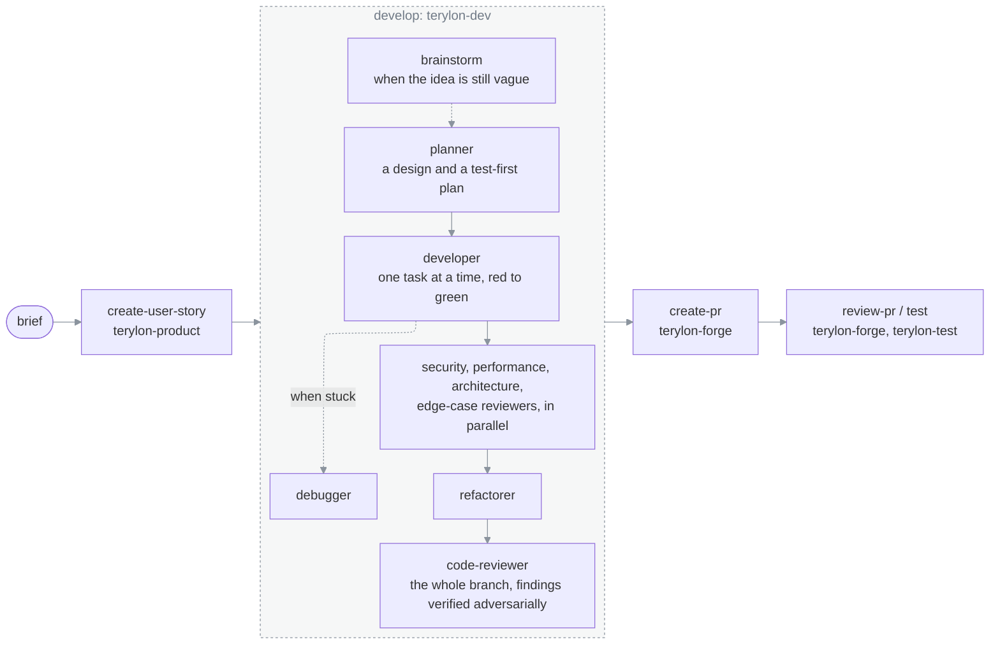
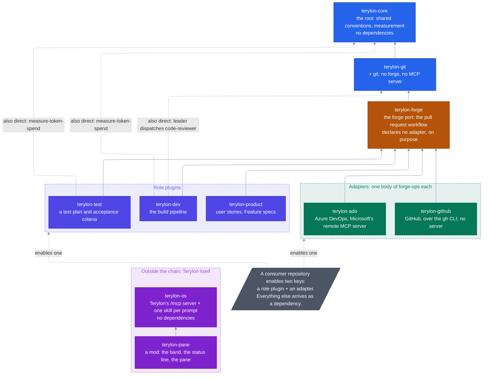

# Terylon Marketplace

[](https://github.com/janecekvit/terylon-marketplace/actions/workflows/ci.yml)
[](https://github.com/janecekvit/terylon-marketplace/actions/workflows/security.yml)
[](https://github.com/janecekvit/terylon-marketplace/actions/workflows/docs.yml)
[](https://codecov.io/gh/janecekvit/terylon-marketplace)
[](https://scorecard.dev/viewer/?uri=github.com/janecekvit/terylon-marketplace)
[](https://github.com/janecekvit/terylon-marketplace/releases)
[](LICENSE)

**A [Claude Code](https://code.claude.com/docs) plugin marketplace that gives Claude the roles of a small development team.** Those roles are a product owner who writes the stories, a developer pipeline that builds them test-first under review, a reviewer for pull requests, and a tester who checks what a pull request claims. It works on **Azure DevOps or GitHub**, in your own repositories. Apache-2.0 licensed.

It also carries **Terylon**, the agentic OS extension: an MCP endpoint and a Claude Desktop pane for the owner of a Terylon, who hands whole goals to an autonomous leader and keeps every decision.

```
  you, in Claude Code
     │
     ├─ "write a story for …" ───────────▶ terylon-product   a codebase-grounded user story or Feature spec
     ├─ "develop <work item>" ───────────▶ terylon-dev       brainstorm → plan → build (TDD) → review → finish
     ├─ "review my changes" ─────────────▶ terylon-git       multi-lens code review, worktree isolation
     ├─ "review <pull request>" ─────────▶ terylon-forge     findings verified, then posted to the PR
     ├─ "verify the test plan on <PR>" ──▶ terylon-test      each claim exercised, not re-read
     │                                          │
     │                     terylon-ado or terylon-github: the same work on either forge
     │
     └─ the Terylon pane and /mcp ───────▶ terylon-os, terylon-pane   goals handed to Terylon's leader
```

## What you get

| You want to | Enable | Then say, or run |
|---|---|---|
| turn a short brief into an implementation-ready user story, or a Feature spec | `terylon-product` | "write a user story for …", `create-user-story`, `create-feature` |
| take a work item or an idea to tested, reviewed code on a branch | `terylon-dev` | "develop \<work item URL\>", `develop`, `brainstorm` |
| review your own branch before you push | `terylon-git` (with any role) | "review my changes", `code-review` |
| open a pull request with a description, or review someone else's | `terylon-forge` (with any role) | `create-pr`, `write-pr-description`, `review-pr <URL>`, `address-pr-comments` |
| know whether a pull request's test plan and its item's acceptance criteria hold | `terylon-test` | "verify the test plan on \<PR URL\>", `test` |
| see what a run cost, per agent | `terylon-core` (with every role) | `measure-token-spend` |
| hand whole goals to your Terylon and keep the decisions | `terylon-os`, `terylon-pane` | the pane in Claude Desktop; `briefing`, `add-goal`, `merge-gate` |

You enable **two** plugins for a repository: the **role** you work in, and the **adapter** for where it is hosted (`terylon-ado` or `terylon-github`). Everything else arrives as a dependency.

**You keep the decisions.** A skill that writes to your forge shows you what it will write and waits for your go-ahead, unless you pass `--auto`; `--dry-run` writes nothing. The development pipeline stops at its gates on the main thread, where only you can answer. The Terylon pane never merges: a merge is a link to Terylon's console, confirmed there with your passkey. Every other decision, a plan approved, a story returned or a pause, is one you take on its card in the pane, and only when you press it.

## How a story travels



Each agent is a role with its own instructions, dispatched by the `leader` and reporting back. Repository-local agents your project ships take over where they fit better, through `delegate-to-repo-agents`. The full dispatch chains are in [`plugins/CLAUDE.md`](./plugins/CLAUDE.md).

## Architecture



The plugin graph is drawn here and only here, from every `plugin.json#dependencies`; an arrow points from a plugin to one it declares, and a dashed one is declared although the chain already reaches it. [`docs/architecture/README.md`](./docs/architecture/README.md) links to it rather than drawing a second copy.

## Plugins

| Plugin | For | Skills | Agents |
|---|---|---|---|
| `terylon-core` | every repository: the conventions every persona shares, and token-spend measurement | `delegate-to-repo-agents`, `measure-token-spend` | — |
| `terylon-git` | any git repository: worktree isolation and the review engine | `code-review`, `create-workspace`, `finish-branch` | `code-reviewer` |
| `terylon-forge` | everyone working through pull requests, on either forge | `create-pr`, `write-pr-description`, `review-pr`, `address-pr-comments`, `update-pr-checklist`, `update-work-item-checklist`, `resolve-forge` | `pr-reviewer` |
| `terylon-ado` | repositories on Azure DevOps, over Microsoft's remote Azure DevOps MCP server | `forge-ops`, `connect`, `check-access` | — |
| `terylon-github` | repositories on GitHub, over the `gh` CLI; no server | `forge-ops` | — |
| `terylon-product` | the product owner or PM | `create-user-story`, `create-feature` | — |
| `terylon-dev` | developers | `develop`, `brainstorm`, `write-plan`, `run-build-loop`, `background-run` | `leader`, `planner`, `developer`, `debugger`, `refactorer`, `security-reviewer`, `performance-reviewer`, `architecture-reviewer`, `edge-case-reviewer` |
| `terylon-test` | anyone holding a checklist that decides something | `test`, `verify-test-plan`, `run-build-and-tests`, `run-ui-flows` | `tester` |
| `terylon-os` | the owner of a Terylon, in any session: terminal, Desktop, SSH, Remote Control | `briefing`, `add-goal`, `review-plan`, `show-story`, `merge-gate`, `hand-over` | — |
| `terylon-pane` | the owner of a Terylon, in Claude Desktop | — (a mod: `/terylon-pane`, `/terylon-memory`) | — |

**`terylon-forge` is a port and ships no adapter, on purpose.** Declaring one would install an Azure DevOps MCP server in every GitHub repository. That is why you enable two keys, and why the adapters are siblings of the role plugins rather than layers under them. The reasoning is in [`docs/architecture/port-and-adapter-split.md`](./docs/architecture/port-and-adapter-split.md).

## Quickstart

**Try it in one session.** In Claude Code, inside the repository you want to work on:

```text
/plugin marketplace add janecekvit/terylon-marketplace
/plugin install terylon-github@terylon
/plugin install terylon-dev@terylon
```

Swap `terylon-github` for `terylon-ado` if that repository is on Azure DevOps, and `terylon-dev` for `terylon-product` or `terylon-test` for another role.

**Share it with a team.** Put this into `.claude/settings.json` of your product repository and commit it, and everyone who opens the repository is offered the same plugins:

```json
{
  "$schema": "https://json.schemastore.org/claude-code-settings.json",
  "extraKnownMarketplaces": {
    "terylon": {
      "source": {
        "source": "git",
        "url": "https://github.com/janecekvit/terylon-marketplace.git",
        "ref": "main"
      },
      "autoUpdate": true
    }
  },
  "enabledPlugins": {
    "terylon-ado@terylon": true,
    "terylon-dev@terylon": true
  }
}
```

On GitHub, swap `terylon-ado@terylon` for `terylon-github@terylon`.

Then point it at your forge:

| Your repositories are on | Do |
|---|---|
| **GitHub** | `gh auth login`, once per machine. Nothing else: the owner comes from the git remote and the adapter registers no server |
| **Azure DevOps** | set `ADO_ORGANIZATION` (your bare organisation **name**: required, no default), `ADO_MCP_CLIENT_ID` and `ADO_MCP_TENANT_ID` (your own Entra app registration and its tenant) in your **own** `~/.claude/settings.json`; run `terylon-ado`'s `connect` skill once, then sign in once in `/mcp` → `ado` → **Authenticate** |

Everything else resolves at runtime: the forge from a pasted URL, then `TERYLON_FORGE`, then the git remote's host; the project and repository from the remote; the target from the URL you pass a skill.

## Terylon, the agentic OS extension

Terylon runs on your own machine and holds your goals. Its leader breaks each goal into a plan of stories, runs each story in a session of its own, and verifies it in its own pull-request environment. It merges only when you say so. These two plugins connect Claude Code to it; they need a Terylon of your own to talk to, reached over your tailnet.

| Plugin | Gives you |
|---|---|
| `terylon-os` | Terylon's `/mcp` server in any Claude Code session, with one skill per prompt it serves: the morning briefing, adding a goal, reviewing a plan, a story's state, the merge gate, a hand-over. Set `TERYLON_URL`; there is no default address and no token |
| `terylon-pane` | in Claude Desktop, three things: a band above the prompt saying what waits for you; a status line with the machine's health and today's spend; and a pane with five tabs (*Queue*, *Goals*, *Bell*, *Memory*, *Status*). The pane answers the leader's questions, adds tasks and goals, follows a running story's stage, agent and tokens, and marks notices handled. It takes your acts on their cards (approve a plan, return, unblock, stop or accept a story, pause the leader, drop a goal, confirm a memory proposal, save the policy) and never merges |

Agentic OS is the only source of truth, and the PC's pane and the phone through Remote Control both reach it through the same `/mcp`. See [one source of truth, reached from two places](./docs/architecture/one-source-of-truth-reached-from-two-places.md), and the READMEs of [`terylon-os`](./plugins/terylon-os/README.md) and [`terylon-pane`](./plugins/terylon-pane/README.md) for setup.

## Where to go next

| Question | Read |
|---|---|
| How do I wire up a repository, in full? | [`docs/onboarding/consumer-setup.md`](./docs/onboarding/consumer-setup.md) |
| I enable `terylon-devops` or `terylon-metrics` — what changed? | [`docs/onboarding/migrating.md`](./docs/onboarding/migrating.md) |
| I want to change the marketplace and test a branch | [`docs/onboarding/marketplace-development.md`](./docs/onboarding/marketplace-development.md) |
| I merged a change and the consumer still runs the old one | [`docs/runbooks/consumer-did-not-get-the-update.md`](./docs/runbooks/consumer-did-not-get-the-update.md) |
| The Azure DevOps tools error, or name an organisation I did not choose | [`docs/runbooks/ado-mcp-authorization-error.md`](./docs/runbooks/ado-mcp-authorization-error.md) |
| How does any of this actually work, and why? | [`docs/`](./docs/README.md) — the engineering knowledge base |
| I am writing a plugin or a mod | [`plugins/CLAUDE.md`](./plugins/CLAUDE.md) — directory conventions, versioning, the engine/transport pattern, mods |

## Versioning

Every `plugin.json` carries a `version`, and a consumer re-fetches **only** when that field changes: a push to `main` without a bump ships nothing. Which digit moves is stated in [`plugins/CLAUDE.md`](./plugins/CLAUDE.md), under *Versioning*.

Every slug carries the `terylon-` prefix, redundantly with the `@terylon` marketplace suffix, so that typing `/terylon` shows commands from every plugin in one filtered list.

## Where it is developed

```
  an issue           the need, its acceptance criteria as a checklist
     │
     ▼
  a feature branch
     │
     ▼
  a pull request     "Closes #N"; CI must be green
     │
     ▼  squash-merged by the maintainer
  main on github.com/janecekvit/terylon-marketplace   ◀── what you install from
     │
     ▼  a vX.Y.Z tag, pushed by the maintainer
  a release
```

This GitHub repository is the marketplace's **only home**: its code, issues, pull requests and releases are all here, and it is the address you install from. Every change starts as an issue that states the need and its acceptance criteria, is made on a branch, and arrives as a pull request that closes the issue. The maintainer merges it, squashed, once CI is green. A release is a `vX.Y.Z` tag; each plugin keeps its own version in its `plugin.json`, and that version, not the tag, is what a consumer's update compares. How to contribute is in [`CONTRIBUTING.md`](./CONTRIBUTING.md).

The marketplace is built with itself: its stories, builds, reviews and test-plan checks run through these plugins.

**A pull request that changes a plugin raises its version.** Change anything under `plugins/<slug>/` and raise `version` in that plugin's `.claude-plugin/plugin.json` in the same pull request — [`.github/workflows/versions.yml`](./.github/workflows/versions.yml) fails it otherwise, and fails a raised major unless the maintainer has labelled the pull request `major`. Run the same check locally with `node tests/versions/check-plugin-versions.js --base origin/main --head HEAD`; which digit to move is in [`plugins/CLAUDE.md`](./plugins/CLAUDE.md), under *Versioning*.

## Continuous integration

[`.github/workflows/ci.yml`](./.github/workflows/ci.yml) runs on every pull request and every push to `main`:

| Job | Runs | Needs |
|---|---|---|
| Unit suites | `node --test "**/*.test.js"`: every skill held to the Agent Skills specification, the forge-port contract and fixture tests, the harness's ref checks, the hook and measurement scripts, the Terylon pane's command and version checks, and the tests of the pane's plan and shards. The pane's mutation and zone suites skip in this job, which installs no `claude` CLI, and run in the pane's own jobs instead | nothing |
| End-to-end install stage | `node tests/e2e/run.js --stages install`: installs the marketplace from the commit under test as a consumer does, and checks every plugin, skill, agent, hook and MCP server loads | nothing: no login, no token, no model call |
| terylon-pane plan | `tests/terylon-pane/needs-pane-suites.js` over the paths the pull request changes: whether the two suites below run. They do when it changes the mod, its tests, the pinned Claude Code or `ci.yml`, and always on a push to `main` | nothing |
| terylon-pane mutations (shard 1/4 to 4/4) | `node --test tests/terylon-pane/mutations.test.js` with `MUTATION_SHARD` set: each planted mutation turning the mod's tests red, a quarter of them per runner, in parallel | the plan said run |
| terylon-pane zones | `node --test tests/terylon-pane/zones.test.js`: the mod's tests green with a time zone planted (the runner is UTC) | the plan said run |
| terylon-pane mod (validate, test, mutations) | `claude plugin validate` and `claude plugin test` on `plugins/terylon-pane`: the mod's own tests against the engine; then the verdict over the plan, the shards and the zones: red if any failed or was cancelled, green when they passed or were skipped. The check `main` requires, on every pull request | nothing: no login, no session, every service stubbed |

The two jobs that need `claude` install the same pinned Claude Code, from the lockfile in [`.github/claude-code/`](./.github/claude-code/package.json) with `npm ci`, every package checked against its integrity hash; Dependabot proposes a newer one 14 days after its release.

The unit suites run with Node's built-in coverage, and the job uploads the lcov report to [Codecov](https://codecov.io/gh/janecekvit/terylon-marketplace) without a stored token (OIDC); coverage is informational there, as set in [`codecov.yml`](./codecov.yml), and never fails a check.

**The harness's other two stages stay manual, on purpose.** `author` and `github-only` drive the skills through a model, headless, and judge what it writes:

- they need a Claude login, and putting one in CI means a repository secret that any workflow change could reach. On a public repository, that is the wrong trade for a check a maintainer can run;
- they cost about $3 a run, and on every push that is a bill for unchanged skills;
- a model's run varies between two identical attempts, and a check that flakes on a pull request teaches people to re-run it rather than read it.

They are run by hand before a change reaches `main`; the commands are in [`CLAUDE.md`](./CLAUDE.md), under *Testing*.

[`.github/workflows/history-check.yml`](./.github/workflows/history-check.yml) warns, on every pull request, about an added code comment that names a pull request, an issue, a work item or a date; it never fails and is never required.

[`.github/workflows/docs.yml`](./.github/workflows/docs.yml) checks every tracked `.md` file on the same triggers: **Markdown lint** holds it to the conventions of [`.claude/rules/markdown.md`](./.claude/rules/markdown.md) as [`.markdownlint-cli2.jsonc`](./.markdownlint-cli2.jsonc) encodes them, and **Links** runs lychee with [`lychee.toml`](./lychee.toml) over every relative link, anchor and external link.

## Security

Report a vulnerability privately, as [`SECURITY.md`](./SECURITY.md) describes, not in a public issue.

## Licence

[Apache-2.0](./LICENSE), copyright Vít Janeček; see [NOTICE](./NOTICE).
