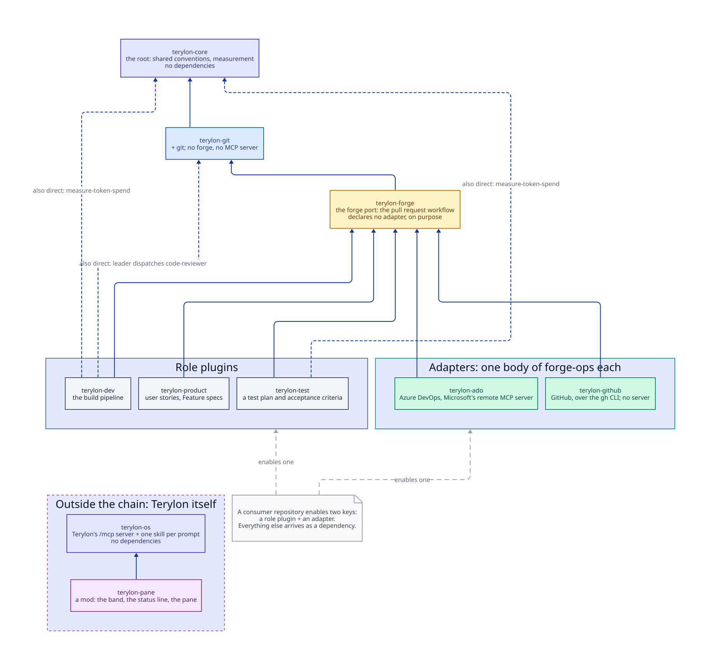
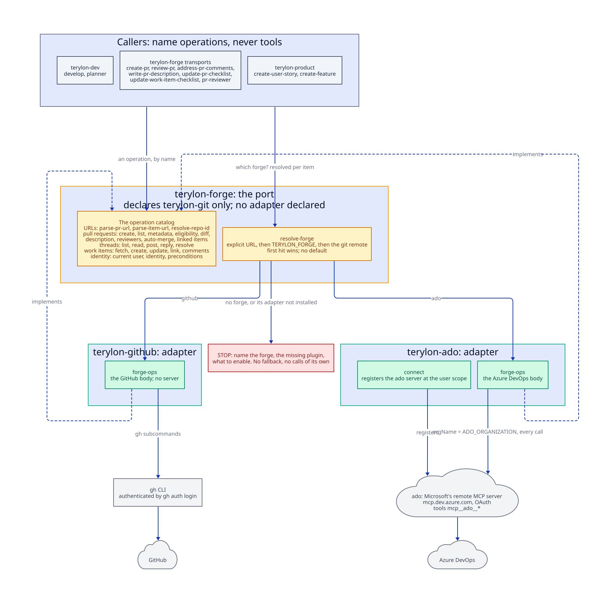
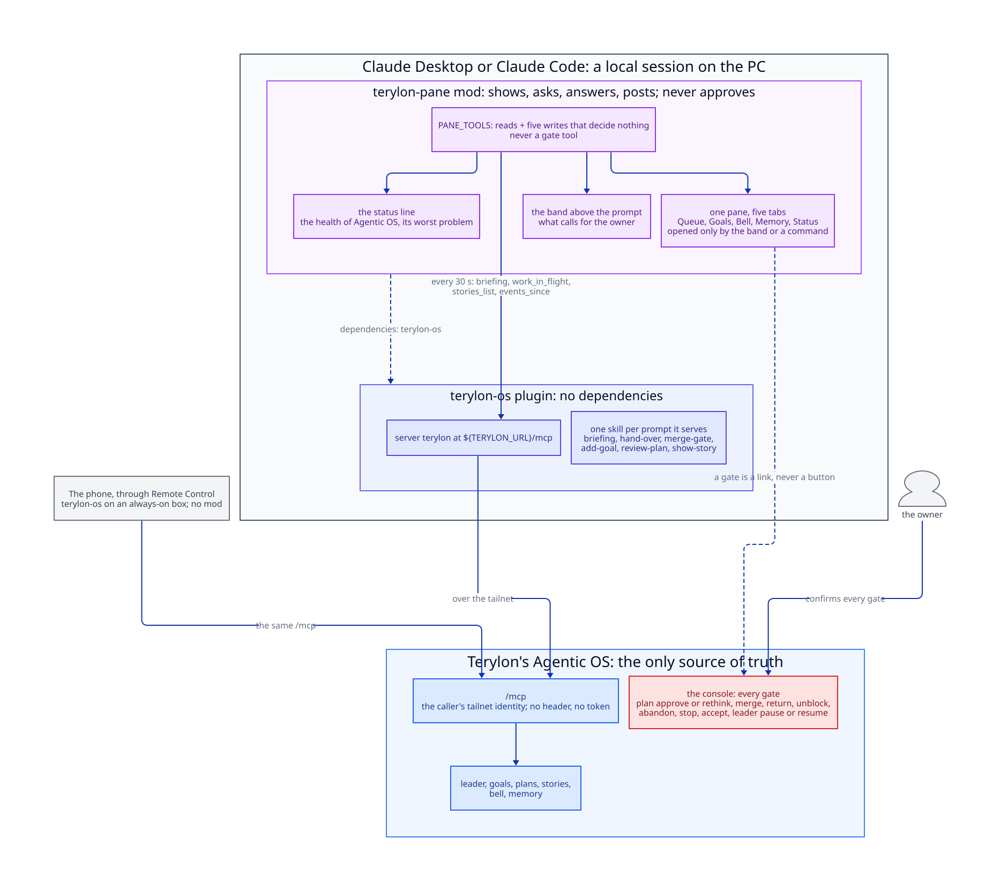

# Architecture

Why this marketplace is shaped the way it is — the static view. **Architecture Decision Records live here**, one decision per file.

An ADR records a decision *and the reasoning that was overturned to reach it*. That is what separates it from the rest of the knowledge base: a flow describes what happens now, an ADR describes why the alternative was rejected.

## Diagrams

The structure of the marketplace, drawn in [D2](https://d2lang.com). Each `.d2` file here is the source of truth for the `.svg` beside it. To change a diagram, edit the `.d2`, run `node Scripts/render-diagrams.js` and commit both files; the Diagrams workflow fails when a source is unformatted or invalid, or when an SVG is stale or missing. Flows over time are drawn as Mermaid in the article that walks them, in [`flows/`](../flows/README.md).

| Diagram | Draws |
|---|---|
| [`plugins.d2`](./plugins.d2) | every plugin and the dependencies its manifest declares, and the two keys a consumer enables |
| [`forge-port.d2`](./forge-port.d2) | the forge port: its operation catalog, `resolve-forge`, and the two adapters that implement it |
| [`terylon-os-and-pane.d2`](./terylon-os-and-pane.d2) | a session reaching Terylon's Agentic OS through `terylon-os`, the `terylon-pane` mod and the owner's acts it takes, and merge, the one gate, which stays in the console |

### The plugins

### The forge port

### terylon-os and the pane

## Articles

| Article | Records |
|---|---|
| [port-and-adapter-split](./port-and-adapter-split.md) | why `terylon-devops` broke into a port and two adapters, and why the port declares no adapter |
| [spend-measured-on-output-tokens](./spend-measured-on-output-tokens.md) | why a run's cost is measured from its own transcripts, weighted, rather than from the harness's figures |
| [superpowers-left-the-dependency-set](./superpowers-left-the-dependency-set.md) | why a dependency on a foreign marketplace was removed, and what replaced its six skills |
| [one-source-of-truth-reached-from-two-places](./one-source-of-truth-reached-from-two-places.md) | why Agentic OS on TerylonLab is the only source of truth, reached through one `/mcp` from the PC's pane and from the phone through Remote Control, and why the pane holds nothing; superseded in part by the next row |
| [the-pane-takes-the-owners-acts](./the-pane-takes-the-owners-acts.md) | why the pane approves, returns, unblocks, pauses and the rest on their subject's cards since Terylon PR 228, and why merge, the one gate, stays in the console behind the passkey |
| [every-rule-has-one-owner](./every-rule-has-one-owner.md) | why a rule is stated once and pointed at everywhere else, what the first sweep found, and why nothing but review enforces it yet |

## Writing one

The shape, in order: a status line and the decision stated as a fact, `Context` (what forced it, with the arrangement that broke drawn), `The alternatives` (a table, one row per option, the chosen one marked), `Decision` (a rule in the present tense), `Consequences` (a table keyed good / cost / **constraint**), optional `Gotchas`, and `Where it lives`.

**The `Consequences` constraint rows are the ones that matter.** Name the specific act that would undo the decision, so the next person recognises it before committing it.

Three further things bind:

**Name the file for the decision, not the problem.** `superpowers-left-the-dependency-set`, not `dependency-review`.

**A reversed decision is superseded, never edited away.** An ADR is a record of what was decided when. Mark the old one superseded, link to the new one, and leave the overturned reasoning readable — the next person needs to see the argument that lost, or they will make it again.

**State the alternative you rejected and why.** An ADR whose Context section admits no other option was available is not recording a decision.

## What does not get an ADR

A decision already stated in full — with its failure mode and its reasoning — in the root `CLAUDE.md`, in `plugins/CLAUDE.md` or in a rule. A second copy diverges from the first, and the reader cannot tell which one is current.

The worked example: **`ADO_ORGANIZATION` having no default gets no ADR.** The root `CLAUDE.md` states that decision in full — the silent failure it prevents, and why a missing required value must fail where it is missing. Every other mention states the requirement in whatever form its own reader needs, and re-argues none of it. An ADR would be one more copy of one argument.
