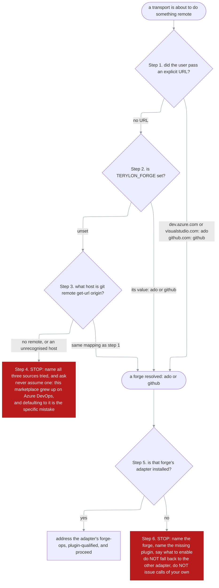

# How a run decides which forge it is talking to

Every transport in `terylon-forge` is written against an operation catalog with two bodies. Before the first operation, something has to answer the one question the catalog cannot: **which body**. This article follows that answer from the inputs a run has available to the engine it ends up addressing — and to the two places it deliberately stops instead.

## The resolution

First hit wins. **There is no default and no guess.**



| Source | Supplies | Precedence |
|---|---|---|
| An explicit URL argument | the forge, plus the coordinates inside it | **highest** — a pasted URL always wins |
| `TERYLON_FORGE` | the forge only | the setting, for a repository whose remote is not the whole story |
| `git remote get-url origin` | the forge, plus owner / project / repo | the normal path |
| nothing resolves | — | **stop**, name what was tried, ask |

**A URL outranks the environment variable on purpose.** Reviewing a GitHub pull request from a checkout of an Azure DevOps repository is an ordinary thing to do, and the URL is the more specific statement of intent.

## What the answer names

| Resolved | Adapter plugin | Engine skill | Server |
|---|---|---|---|
| `ado` | `terylon-ado` | `terylon-ado:forge-ops` | the user-scope `ado` MCP server, registered by `terylon-ado`'s `connect`; needs `ADO_ORGANIZATION` |
| `github` | `terylon-github` | `terylon-github:forge-ops` | none — the `gh` CLI |

**Address the engine plugin-qualified whenever a forge resolved.** Both adapters ship a skill named `forge-ops`. With one installed the bare name resolves; with both enabled it is ambiguous, and the qualified form is correct in either case.

## Why one node invocation reads the environment

`resolve-forge` holds `Bash(git *)` and `Bash(node *)`, and the second grant exists for one reason: **nothing in `Read`, `Grep` or `Glob` can read an environment variable at all**, and `Bash(git *)` covers `git remote get-url` and nothing else. One node invocation reads the variable and the remote together, which is a narrower grant than the shell form it replaces.

```bash
node -e '
const { execSync } = require("child_process");
let remote = "";
try { remote = execSync("git remote get-url origin", { stdio: ["ignore", "pipe", "ignore"] }).toString(); } catch {}

const fromRemote =
    /dev\.azure\.com|visualstudio\.com/.test(remote) ? "ado" :
    /github\.com/.test(remote)                       ? "github" : "";

console.log(process.env.TERYLON_FORGE || fromRemote || "");
'
```

An empty result is step 4. The variable outranks the remote; a pasted URL outranks both and is decided before this runs.

## The two stops are the point

A resolution that guesses is worse than one that fails, because the output looks right and is addressed to the wrong platform.

| Situation | What the run does |
|---|---|
| The forge resolved, its adapter is installed | proceed |
| The forge resolved, its adapter is **not** installed | stop. Name the forge, the missing plugin, and what to enable. **No fallback to the other adapter**, no calls of its own |
| No forge resolved | stop. Say what was tried — URL, variable, remote — and ask |

**Never hand-roll the mechanics.** A transport that issues its own platform calls because the engine was absent puts the call shapes in a second place, and the copy is the one that goes stale. The port exists to keep exactly one.

## Reporting

Say which forge resolved and from what, in one line, **before the first operation**:

```
Forge: github (from the git remote).
```

A wrong resolution is cheap to correct at that point and expensive afterwards, because everything downstream is addressed to the wrong platform.

## Gotchas

**Resolving once does not settle a run.** Several items in one run may name different forges — a GitHub pull request and an Azure DevOps work item are an ordinary pair. **Resolve per item.**

**Both adapters enabled is supported, not a misconfiguration.** `TERYLON_FORGE` then decides, and the plugin-qualified engine name is what keeps the load unambiguous.

**Defaulting to `ado` because this marketplace grew up there is the mistake this flow exists to prevent.** Step 4 is to stop, not to fall back.

**`ADO_ORGANIZATION` is not part of resolution.** Resolution picks the platform; the organisation is a separate required value with no default, passed as `orgName` in every `mcp__ado__*` call — never derived from the remote and never part of the server's URL. An unset one fails the first call rather than targeting an organisation nobody chose. See [`runbooks/ado-mcp-authorization-error.md`](../runbooks/ado-mcp-authorization-error.md).

## Where it lives

| File | Role |
|---|---|
| `plugins/terylon-forge/skills/resolve-forge/SKILL.md` | `resolve-forge` — the precedence, the node reader, the adapter table, the stop conditions |
| `plugins/terylon-ado/skills/forge-ops/SKILL.md` | the Azure DevOps body — the recipes and the asymmetry table |
| `plugins/terylon-github/skills/forge-ops/SKILL.md` | the GitHub body — the same catalog over `gh`, and the matching asymmetry table |
| `plugins/terylon-ado/skills/connect/SKILL.md` | `connect` — registers the remote `ado` server at the user scope, from `ADO_MCP_CLIENT_ID` and `ADO_MCP_TENANT_ID` |
| `plugins/terylon-forge/.claude-plugin/plugin.json` | `dependencies` — `terylon-git` only; declaring an adapter here would break the port |
| `docs/architecture/port-and-adapter-split.md` | why the port ships no adapter, and the three rules that keep the arrangement honest |
